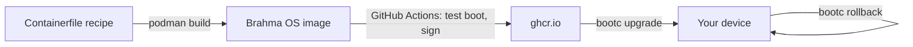

<div align="center">

<h1>Brahma OS</h1>

<h4>One private, customisable system for your laptop, phone and TV, kept safe by updates you can always undo.</h4>

<a href="LICENSE"></a>

<a href="https://github.com/sudharamachandranrajeev/brahma-life-suite"></a>

<p>
<a href="#-what-it-does">What it does</a> •
<a href="#-get-started">Get started</a> •
<a href="#-how-it-works">How it works</a> •
<a href="#-faq">FAQ</a> •
<a href="#%EF%B8%8F-for-developers">For developers</a>
</p>

</div>

Brahma OS turns a PC or laptop into a Brahma device: the Brahma apps, your data encrypted on the
device, and optional sync with your other devices. This repository builds the **Desktop edition**.

> [!WARNING]
> This is an early **developer preview**. It is not secure yet (no Brahma-signed Secure Boot), it
> has no desktop yet, and it may break. Install it only on a spare or external disk.

## ✨ What it does

- 🔁 **Updates you can undo** – the whole system updates as one piece; if something goes wrong,
  pick the previous version at boot.
- 🧊 **A system that stays clean** – the core is read-only, so apps and mistakes can't damage it.
- ⚡ **A fast, modern kernel** – the CachyOS kernel, tuned for desktops.
- 🔏 **Signed builds** – every published image is signed, with a list of everything inside it.
- 🧩 **Built in the open** – the image is a plain recipe (a `Containerfile`) anyone can read and rebuild.

Coming next (see the plan in the Brahma repository): the Brahma desktop shell, a first-run setup,
and an installer for external drives.

## 🚀 Get started

For now Brahma OS runs in a virtual machine. You need a Linux PC with `podman`, `qemu` and the
UEFI firmware package (`edk2-ovmf` on Arch, `ovmf` on Debian and Ubuntu).

1. **Get the code**

   ```bash
   git clone https://github.com/sudharamachandranrajeev/brahma-os
   cd brahma-os
   ```

2. **Build the image.** The first build compiles one part (bootc) and takes about 40 minutes;
   later builds take a few minutes.

   ```bash
   scripts/build.sh
   ```

3. **Make a disk file** you can boot. This step needs your password, because it uses a loop device.

   ```bash
   ssh-keygen -t ed25519 -N '' -f build/vm_key
   sudo scripts/disk.sh build/brahma-os.img build/vm_key.pub
   ```

4. **Start it and check it**

   ```bash
   KEEP=1 scripts/smoke.sh build/brahma-os.img build/vm_key
   ssh -i build/vm_key -p 2222 root@127.0.0.1
   ```

   `smoke.sh` prints `PASS` when the system started cleanly.

## 🧭 How it works



- The system is a container image. `bootc` installs it to a disk and later updates it in place.
- Every update is staged in the background and used at the next restart. The previous version
  stays on the disk, so you can go back.
- GitHub Actions builds the image every day (`testing`) and every Sunday (`stable`), boots it in
  a virtual machine, and only then publishes and signs it.

## ❓ FAQ

<details>
<summary>Can I install it on my main disk?</summary>

Not yet, and please don't. Use a virtual machine or a spare external drive.
</details>

<details>
<summary>Which devices are supported?</summary>

64-bit Intel and AMD PCs with UEFI. Phones, TVs and ARM boards come in later phases.
</details>

<details>
<summary>How do I check that an image is genuine?</summary>

```bash
cosign verify --key cosign.pub ghcr.io/sudharamachandranrajeev/brahma-os:testing
```
</details>

## 🛠️ For developers

<details>
<summary>Layout, build and CI</summary>

- `bootc-builder/` – compiles bootc once per pinned release (no working prebuilt bootc exists
  for Arch). Change `BOOTC_TAG` to update it.
- `image/` – the Brahma OS image recipe.
- `scripts/` – `build.sh`, `disk.sh` (disk file for virtual machines), `smoke.sh` (boot test).
- `.github/workflows/build.yml` – build, rechunk, boot test, push, sign, SBOM.

Notes for Claude Code sessions are in [CLAUDE.md](CLAUDE.md).
</details>

<details>
<summary>Credits</summary>

- [bootc](https://github.com/bootc-dev/bootc) and [bootcrew](https://github.com/bootcrew/mono),
  whose Arch Linux image this recipe is based on
- [Arch Linux](https://archlinux.org) and the [CachyOS](https://cachyos.org) kernel
- [chunkah](https://github.com/coreos/chunkah), [cosign](https://github.com/sigstore/cosign) and
  [syft](https://github.com/anchore/syft)
</details>

## Licence

[Apache License 2.0](LICENSE). Parts come from other projects under their own licences; see [NOTICE](NOTICE).
